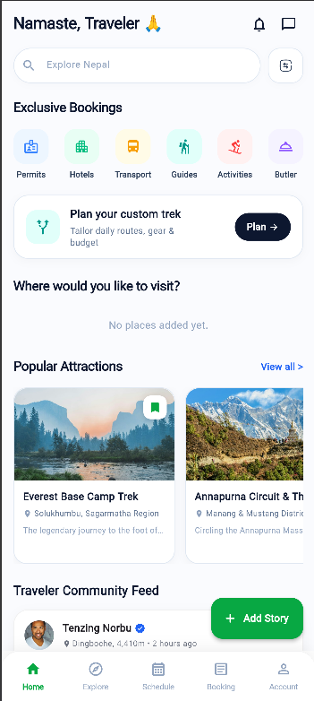
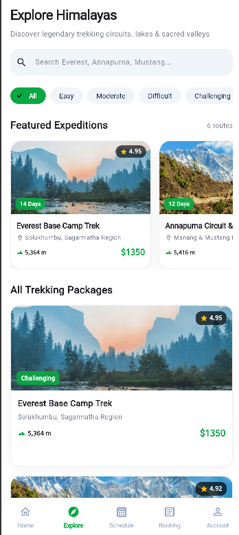
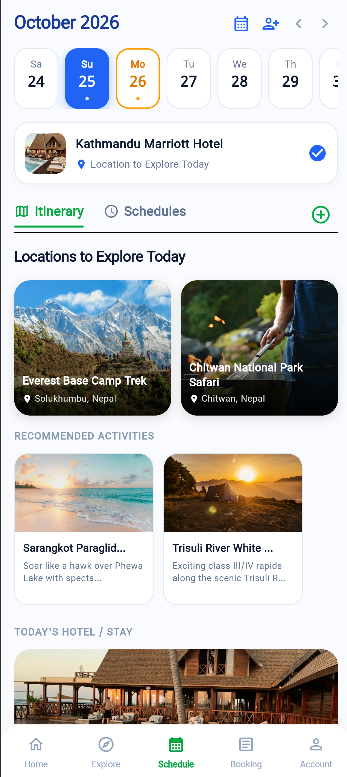
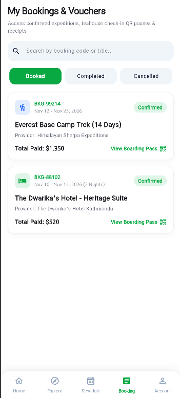

# 🏔️ Visit Nepal - Travel & Expedition App

A modern, cross-platform Flutter application designed for exploring Nepal's legendary Himalayan treks, heritage sites, wildlife safaris, and cultural experiences.

---

## 📖 About the App

**Visit Nepal** is an all-in-one travel companion for adventurers, trekkers, and tourists exploring Nepal. The app delivers a seamless travel experience with feature-packed tabs:

- **🏠 Home (`Home`)**: Search top destinations, trending travel posts, local guides, permits, and curated Himalayan experiences with smart discovery controls.
- **🧭 Explore (`Explore`)**: Discover filtered trekking circuits (Everest Base Camp, Annapurna, Mustang, etc.), difficulty filters, altitude stats, pricing, and detailed itinerary packages.
- **📅 Schedule (`Schedule`)**: Interactive daily itinerary planner, calendar date strip, hotel stays, altitude acclimatization reminders, and live GPS sync with trek companions.
- **🎟️ Booking (`Booking`)**: Easily manage active adventure bookings, trek permits, hotel reservations, and direct guide/support messaging.
- **👤 Profile (`Profile`)**: Manage saved places, account credentials, verification badges, documents, settings, and theme customization.

---

## 🖼️ App Screenshots Showcase

| Home Screen | Explore Screen |
| :---: | :---: |
|  |  |

| Schedule Screen | Booking Screen | Profile Screen |
| :---: | :---: | :---: |
|  |  |  |

---

## 🚀 Getting Started

### Prerequisites
- [Flutter SDK](https://docs.flutter.dev/get-started/install) (3.x or higher)
- Android Studio / VS Code with Flutter & Dart plugins

### Installation
1. **Clone the repository**:
   ```bash
   git clone https://github.com/your-username/visitnepal.git
   cd visitnepal
   ```

2. **Install dependencies**:
   ```bash
   flutter pub get
   ```

3. **Run the application**:
   ```bash
   flutter run
   ```
